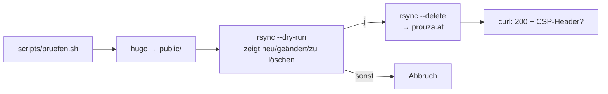

# Deployment

Status: `bereit` – erster Lauf auf Produktion am 2026-11-10. Offen: `.htaccess` wird am Server ignoriert (siehe unten); danach Kontrolle und `erledigt`.

Veröffentlichung der gebauten Seite auf dem Produktiv-Webserver.

```bash
./scripts/veroeffentlichen.sh
```



## Entscheidungen

* 2026-11-10: Die neue Seite **ersetzt die alte in Produktion** am bisherigen Ziel `prouza.at:/var/customers/webs/prouza/var/www/prouza.at/` – keine Test-Adresse.
* 2026-11-10: Webserver ist **Apache**; Security-Header, Weiterleitungen und 404-Seite kommen aus `static/.htaccess` (lokal mit Apache 2.4 getestet).
* 2026-11-10: `rsync --delete` – Dateien der alten Seite, die es nicht mehr gibt, werden entfernt. Vorher zeigt ein Probelauf die betroffenen Dateien, veröffentlicht wird erst nach Bestätigung. `.well-known/` am Server ist geschützt (z. B. Let's-Encrypt-Validierung).
* 2026-11-10: `--checksum` statt Zeitstempel: Hugo schreibt bei jedem Build alle Dateien neu, übertragen werden trotzdem nur geänderte.
* 2026-11-10: Skript `scripts/veroeffentlichen.sh` (wie bei Profito); `--probelauf` zeigt nur die vollständige Liste der Änderungen. Ziel und Kontroll-URL über `ZIEL=` / `URL=` überschreibbar (zum Testen gegen ein lokales Verzeichnis).
* 2026-11-10: VS-Code-Befehle wie bei Profito (Erweiterung Command Runner, `.vscode/settings.json`): Veröffentlichen, Probelauf, Sicherung holen, Header prüfen, Fehler-/Zugriffs-Log, Vorschau (mit/ohne Entwürfe), Prüfen.
* 2026-11-10: Die `.htaccess` am Server (vor dem Umstieg) leitete Browser je nach `Accept-Language` auf `/en/` oder `/de/`. Übernommen für die Startseite: Englisch als erste Sprache → `/en/` (302), sonst `/de/`. Gesichert in `~/prouza.at-sicherung-2026-11-10/.htaccess`.
* 2026-11-10: `img/cec2024.png` und `img/coder/*` lagen nur am Server (nicht im Repo der alten Seite) – vor dem ersten `--delete` aus der Sicherung übernommen.
* 2026-11-10: Erster Lauf: 179 Dateien übertragen, 596 Dateien der alten Seite gelöscht (Sicherung in `~/prouza.at-sicherung-2026-11-10/`). Befund: `apache2.conf` setzt für `/var/customers/webs/` `AllowOverride None` – die `.htaccess` (auch die alte) wird ignoriert. Folge: keine Security-Header, keine eigene 404-Seite, keine Weiterleitungen für URLs ohne Sprachpräfix und keine Sprachweiche auf `/`. Seiten unter `/de/` und `/en/` inkl. aller Hugo-Aliase funktionieren.
* 2026-11-10: Alte URLs ohne Sprachpräfix (`/about/`, `/schulungen-*/`, `/posts/*`), alte RSS-Feeds (`/index.xml`, `/posts/index.xml`) und der nicht veröffentlichte SQL-Workshop (`/schulungen-sql/`) leiten per `RedirectMatch` in `.htaccess` weiter – diese lagen auf der alten Seite im Wurzelverzeichnis und wären nach `--delete` sonst 404. Tag-, Kategorie- und Archivseiten des alten Themes entfallen (404).

## Umstieg (einmalig)

1. Sicherung der alten Seite lokal ziehen:
   ```bash
   rsync -a prouza.at:/var/customers/webs/prouza/var/www/prouza.at/ ~/prouza.at-sicherung-$(date +%F)/
   ```
2. `./scripts/veroeffentlichen.sh` – im Probelauf die Löschliste durchsehen: Dateien, die nicht von der alten Hugo-Seite stammen, vorher in `SCHUTZ` im Skript aufnehmen.
3. Kontrolle im Browser (hell/dunkel, Desktop/Handy) und Stichproben alter URLs, z. B. `/de/schulungen-rpg/`, `/about/`, `/posts/git/`.
4. Notfalls zurück: Sicherung mit `rsync -a --delete ~/prouza.at-sicherung-…/ prouza.at:/var/customers/webs/prouza/var/www/prouza.at/`.

## Akzeptanzkriterien

* [x] `scripts/veroeffentlichen.sh` bricht ab, wenn `pruefen.sh` fehlschlägt
* [x] Probelauf zeigt Anzahl der geänderten Dateien und die Löschliste; ohne `j` wird nichts geändert
* [x] `.well-known/` am Server bleibt erhalten
* [x] Lokaler Test mit Apache: CSP und Security-Header gesetzt, alte URLs leiten weiter, 404-Seite greift
* [x] Produktion: `https://www.prouza.at/de/` liefert 200 (2026-11-10)
* [ ] Produktion: `Content-Security-Policy`- und Security-Header gesetzt
* [ ] Produktion: alte URLs leiten weiter (Stichproben wie oben)
