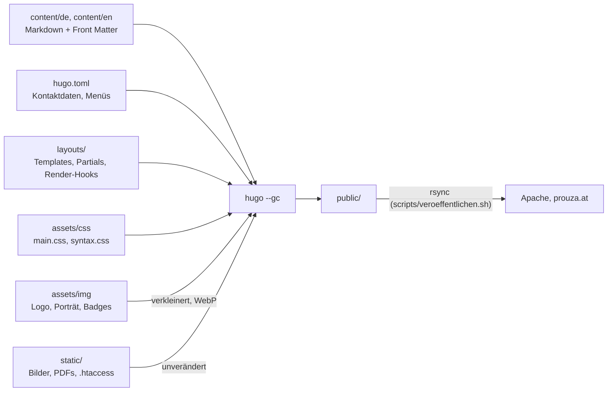

# Technik

## Aufbau



| Ordner | Inhalt |
|---|---|
| `content/<sprache>/` | Seiten. Sektionen `workshops/` und `news/`, Einzelseiten `ueber-mich`, `produkte`, `kontakt`, `impressum` |
| `layouts/` | `baseof.html` (Gerüst), `home.html`, `page.html`, `section.html`, eigene Layouts `about`, `products`, `contact` (Front Matter `layout:`), Sektionen `workshops/`, `news/` |
| `layouts/_partials/` | `head`, `header`, `footer`, `cta` (Kontakt-Band), `icon` (SVG-Icons), `logo`, `news-card`, `static-img`, `link-url` (Links aus dem Front Matter) |
| `layouts/_markup/` | Render-Hooks für Links und Bilder im Markdown (Prüfung, siehe unten) |
| `i18n/` | feste Texte der Templates (de/en) |
| `assets/` | CSS und Bilder, die Hugo verarbeitet (Fingerprint, Skalierung) |
| `static/` | Dateien, die 1:1 kopiert werden |
| `scripts/pruefen.sh` | Build + Prüfungen |
| `scripts/veroeffentlichen.sh` | Prüfen, Build, rsync auf den Webserver – siehe [Deployment](features/deployment.md) |

Die URLs der alten Seite (`/de/schulungen-rpg/`, `/de/about/`, `/de/posts/…`) bleiben über `aliases` im Front Matter erreichbar (Weiterleitung per Meta-Refresh).

## Entwicklung

```bash
hugo server            # Vorschau mit Live-Reload
./scripts/pruefen.sh   # vor jedem Commit
```

`./scripts/pruefen.sh` bricht ab bei:

* fehlenden Bildern oder Dateien (`/img/…`, `/doc/…`) und toten internen Links im Markdown – geprüft von `layouts/_markup/render-link.html` und `layouts/_partials/static-img.html`
* toten Links im Front Matter (`link:` bei Leistungen und Projekten, auch Anker wie `/produkte#imail` gegen die Produkt-IDs) – geprüft von `layouts/_partials/link-url.html`
* externen Bildern im Markdown
* rohem HTML im Markdown (Hugo-Warnung, `--panicOnWarning`)
* unbekannten Icon-Namen und unbekannten Workshop-Gruppen
* externen Bildern, Stylesheets oder Icons im erzeugten HTML
* JavaScript im erzeugten HTML
* Seiten, die es nur in einer Sprache gibt

## Bilder

* `static/img/…` wird unverändert ausgeliefert; Breite und Höhe ermittelt das Template.
* `assets/img/…` wird von Hugo verarbeitet: Logo (Ausschnitt), Porträt (WebP), Badges (verkleinert). Im Markdown referenziert man auch diese mit `/img/…`; ist die Datei unter `assets/` vorhanden, wird sie auf max. 1200 px verkleinert.

## Syntax-Highlighting

Chroma mit CSS-Klassen (`noClasses = false`), damit die CSP ohne `'unsafe-inline'` auskommt.
`assets/css/syntax.css` ist generiert:

```bash
{ echo '/* Generiert mit: hugo gen chromastyles --style=github bzw. github-dark */'; \
  hugo gen chromastyles --style=github; echo '@media (prefers-color-scheme: dark) {'; \
  hugo gen chromastyles --style=github-dark; echo '}'; } > assets/css/syntax.css
```

## Sicherheit

* Kein JavaScript, keine Formulare, keine externen Ressourcen, keine Cookies – die Angriffsfläche ist der Webserver selbst.
* `static/.htaccess` setzt für Apache: Content-Security-Policy (`default-src 'none'`, nur eigene Bilder/Videos/Styles), `X-Content-Type-Options`, `Referrer-Policy`, `Permissions-Policy`, `X-Frame-Options`, Caching und die 404-Seite. Alles in `<IfModule>`, damit ein fehlendes Modul keinen Fehler 500 auslöst.
* Das Stylesheet wird mit Subresource Integrity (`integrity=`) eingebunden.
* Markdown darf kein rohes HTML enthalten; Links nach außen bekommen `rel="noopener"`.

## Package-Prüfung

| Package | Version | Ergebnis |
|---|---|---|
| Hugo | 0.169 | Werkzeug, kein Laufzeit-Package. GitHub gohugoio/hugo, > 80 000 Sterne, aktiv gepflegt |

## Entscheidungen

* 2026-11-10: Hugo statt Python-Generator oder Node-Tooling: ein Binary, schon installiert, Markdown + Mehrsprachigkeit eingebaut.
* 2026-11-10: Kein Theme und kein Tailwind (anders als die alte Seite): kein Pinning auf alte Theme-Commits, kein npm-Build, volle Kontrolle über das Markup.
* 2026-11-10: Systemschriften statt Webfonts (Google Fonts überträgt IP-Adressen an Google).
* 2026-11-10: Credly-Badges als lokale Bilder mit Link statt Credly-Embed-Skript.
* 2026-11-10: Neue Layout-Struktur von Hugo ≥ 0.146 (`layouts/_partials`, `layouts/_markup`, `home.html`, `page.html`, `section.html`).
